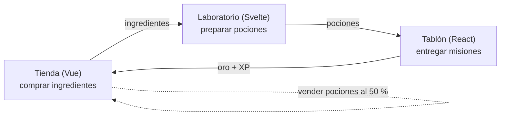
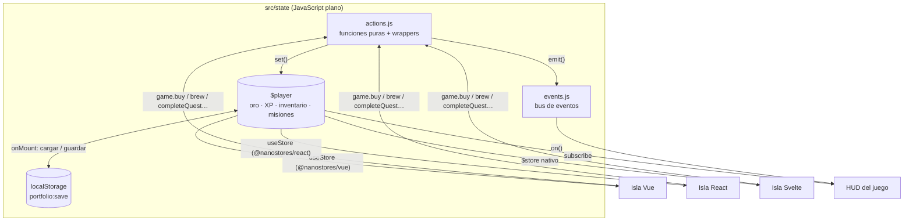

# Guillermo Domínguez · Portfolio de 8 bits

Portfolio jugable de 8 bits. Recorre el pueblo y entra en cada edificio para ver una skill hecha con su propio framework, junto a un cartel con las buenas prácticas que aplica.

Hecho con Astro (islas), un motor propio en Canvas 2D y sprites dibujados con código.

```sh
npm install
npm run dev
npm test        # tests de la lógica del juego (Vitest)
```

Cómo está construido: [docs/ARQUITECTURA.md](docs/ARQUITECTURA.md).

## Arquitectura del estado

Las tres demos forman un único juego con una partida compartida:



Cada demo es una isla de Astro que se hidrata por separado, así que no comparten ningún árbol de componentes. La partida vive fuera de ellas, en [nanostores](https://github.com/nanostores/nanostores), y solo cambia a través de acciones:



- **Las acciones** son funciones puras `(estado, args) → { ok, state } | { ok: false, reason }`. Si algo no cuadra, el estado no cambia, y cada demo muestra el motivo con su propio estilo.
- **Los eventos** (`potion:brewed`, `quest:completed`, `level:up`…) le dicen al juego qué acaba de pasar, para mostrar notificaciones al estilo Pokémon.
- **La persistencia** solo funciona en el navegador y valida lo que lee: si `portfolio:save` está corrupto, se empieza una partida nueva sin errores.
- **El SSR no se rompe:** cada isla pinta el estado inicial hasta montarse y después pasa a la partida guardada.

Por qué elegí nanostores y no otras opciones: [ADR 001](docs/adr/001-estado-compartido-entre-islas.md).
